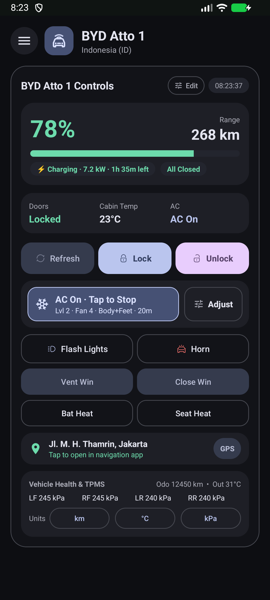
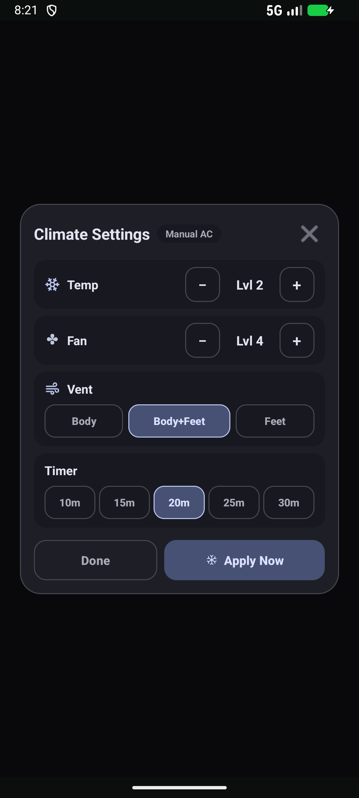
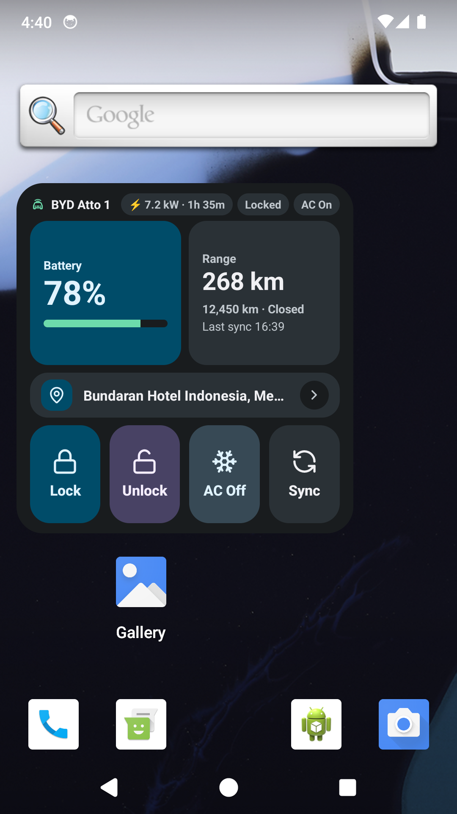
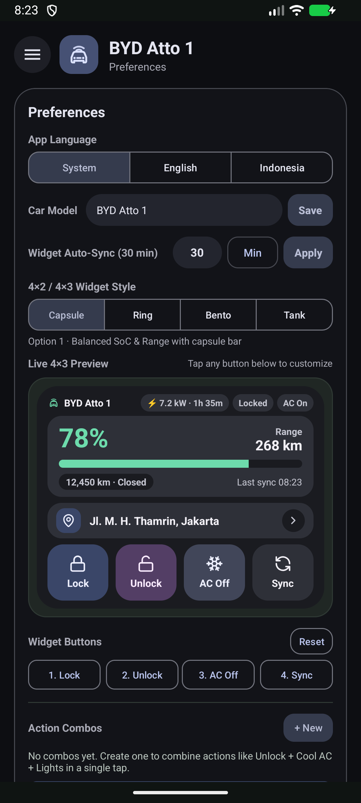
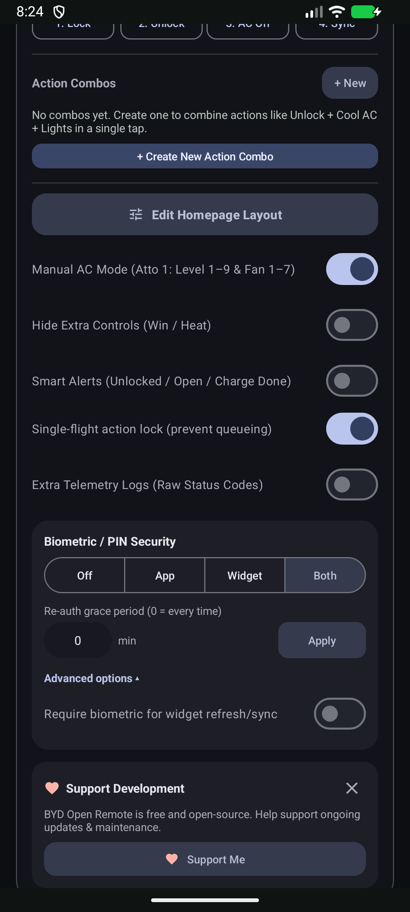
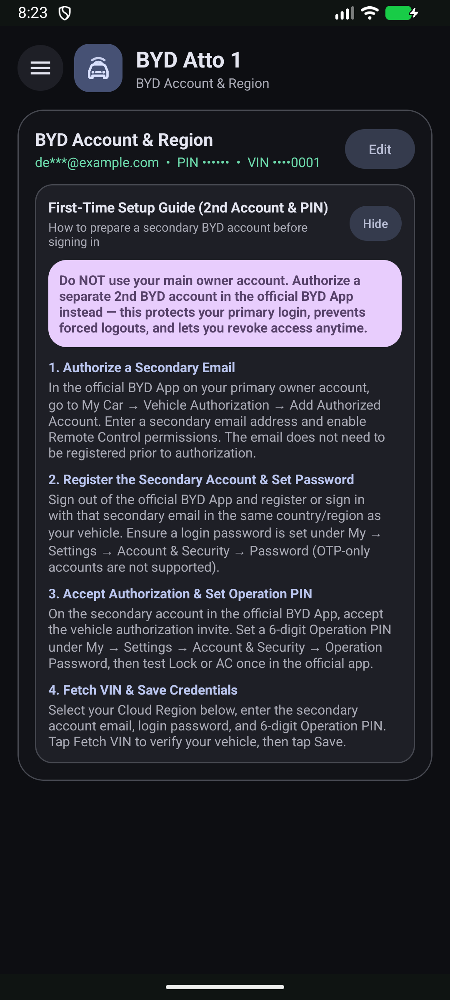
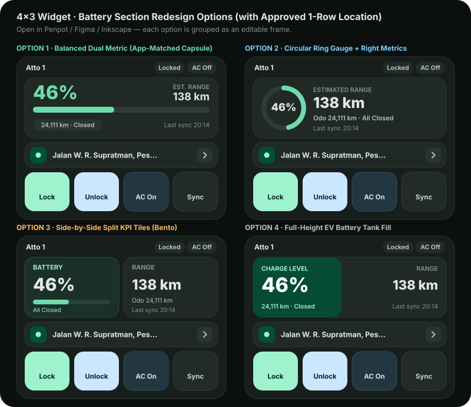
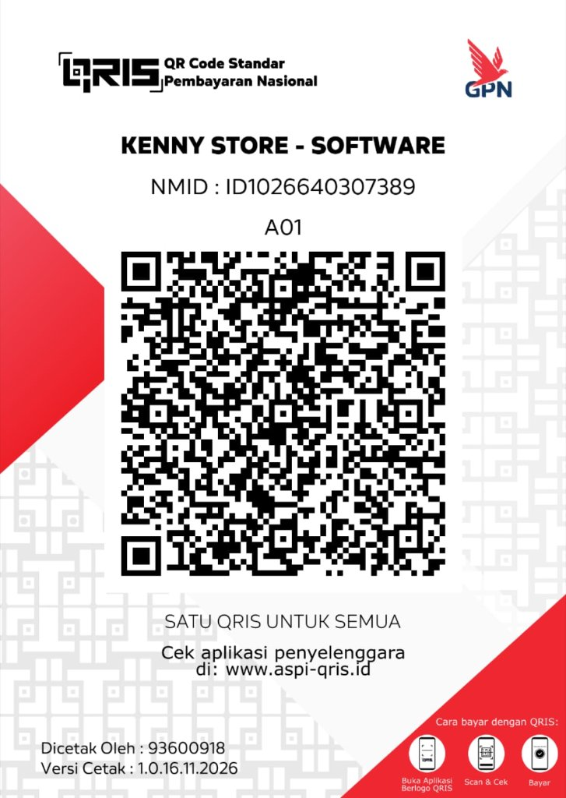

# BYD Open Remote

[](README.md)
[](README.id.md)

Aplikasi remote control Android & widget layar utama Material You yang gratis, open-source, dan tidak resmi untuk kendaraan BYD yang terhubung ke BYD DiLink Cloud (`com.bydopenremote.app`).

[](https://github.com/kennyric/byd-open-remote/releases/latest)
[](https://github.com/kennyric/byd-open-remote/releases/latest/download/BYD-Open-Remote.apk)

> **Instalasi Cepat:** **[Unduh BYD-Open-Remote.apk](https://github.com/kennyric/byd-open-remote/releases/latest/download/BYD-Open-Remote.apk)** atau buka **[GitHub Releases](https://github.com/kennyric/byd-open-remote/releases/latest)**, lalu ikuti **[Panduan Persiapan Akun Kedua](#panduan-persiapan-akun-kedua-byd)** di bawah sebelum masuk.
>
> Saat memasang `.apk`, aktifkan izin **Instal aplikasi tidak dikenal (*Install unknown apps*)** bila diminta. Jika muncul dialog Google Play Protect, pilih **Selengkapnya (*More details*) → Tetap instal (*Install anyway*)**.

> [!IMPORTANT]
> **Rekomendasi Keamanan — Selalu Gunakan Akun Kedua BYD:** Jangan masuk menggunakan akun pemilik utama Anda. Otorisasi alamat email kedua dari akun utama Anda di aplikasi resmi BYD dengan izin **Kontrol Jarak Jauh**, atur kata sandi login & PIN Operasi 6 digit pada akun kedua tersebut, uji satu perintah remote di aplikasi resmi, lalu masuk ke **BYD Open Remote**.

> [!NOTE]
> **Catatan Pendamping Jam Tangan:** Proyek ini awalnya dimulai bersama bridge Huawei Watch GT 4, sehingga namespace paket lama (`com.bydwatch.companion`) masih ada di sebagian kode. **Integrasi Huawei Watch saat ini belum berfungsi** — gunakan **aplikasi ponsel Android, Quick Settings tile, dan widget layar utama** yang berjalan mandiri tanpa jam tangan.

> **Penafian:** Proyek komunitas open-source independen oleh **Kenny Ricardo**, tidak berafiliasi, didukung, atau terhubung dengan BYD Co. Ltd. **Perangkat lunak gratis — *Tidak diperuntukkan untuk jual beli*.**

---

## Demo Fitur & Tangkapan Layar

*Seluruh tangkapan layar di bawah diambil pada emulator Android menggunakan data dummy.*

<table>
  <tr>
    <td align="center"><b>Kontrol &amp; Telemetri Kendaraan</b></td>
    <td align="center"><b>Popup AC Manual / Otomatis</b></td>
    <td align="center"><b>Widget Layar Utama 4×3</b></td>
  </tr>
  <tr>
    <td align="center"></td>
    <td align="center"></td>
    <td align="center"></td>
  </tr>
  <tr>
    <td align="center"><b>Pemilih Gaya Widget 4×3</b></td>
    <td align="center"><b>Kunci Aksi &amp; Keamanan Biometrik</b></td>
    <td align="center"><b>Panduan Akun Kedua di Aplikasi</b></td>
  </tr>
  <tr>
    <td align="center"></td>
    <td align="center"></td>
    <td align="center"></td>
  </tr>
  <tr>
    <td align="center" colspan="3"><b>Keempat Pilihan Gaya Kartu Baterai</b></td>
  </tr>
  <tr>
    <td align="center" colspan="3"></td>
  </tr>
</table>

---

## Panduan Persiapan Akun Kedua BYD

Menyiapkan akun kedua khusus di aplikasi resmi **BYD App** hanya membutuhkan ~2 menit dan menjaga sesi akun utama Anda tetap aktif tanpa terkeluar otomatis:

1. **Otorisasi Email Kedua dari Akun Utama**
   - Di aplikasi resmi **BYD App** pada **akun pemilik utama**, buka **Mobil Saya → Otorisasi Kendaraan → Tambah Akun**.
   - Masukkan alamat email kedua dan aktifkan izin **Kontrol Jarak Jauh** (Kunci/Buka Kunci, AC/Iklim, Lampu/Klakson). *Email kedua belum perlu terdaftar sebagai akun BYD sebelum otorisasi dikirim.*
2. **Daftarkan Akun Kedua &amp; Atur Kata Sandi Login**
   - Keluar dari aplikasi resmi BYD, lalu daftar atau masuk menggunakan email kedua pada **negara/wilayah yang sama** dengan kendaraan Anda.
   - Pastikan akun kedua memiliki **kata sandi login** melalui **Saya → Pengaturan → Akun &amp; Keamanan → Kata Sandi** *(akun yang hanya memakai kode OTP email tidak dapat digunakan)*.
3. **Terima Undangan &amp; Atur PIN Operasi 6 Digit**
   - Saat masuk menggunakan akun kedua di aplikasi resmi BYD, terima undangan otorisasi kendaraan.
   - Buka **Saya → Pengaturan → Akun &amp; Keamanan → Kata Sandi Operasi**, atur **PIN Operasi 6 digit** (berbeda dari kata sandi login), lalu uji ketuk **Kunci** atau **AC** satu kali di aplikasi resmi untuk memastikan PIN aktif di server BYD.
4. **Verifikasi VIN &amp; Simpan Kredensial di BYD Open Remote**
   - Buka **BYD Open Remote → Akun BYD &amp; Wilayah**.
   - Pilih **Wilayah Cloud** yang sesuai (misalnya `Indonesia (ID)`), lalu masukkan email akun kedua, kata sandi login, dan PIN Operasi 6 digit.
   - Ketuk **Ambil VIN** hingga nomor rangka (VIN) terisi otomatis, lalu ketuk **Simpan**.

> [!TIP]
> **Mengapa perlu akun kedua?**
> - Mencegah sesi aplikasi resmi BYD di ponsel utama terkeluar otomatis saat widget melakukan sinkronisasi latar belakang.
> - Memudahkan Anda mencabut atau menjeda akses kontrol jarak jauh kapan saja dari akun pemilik utama.
> - Memastikan PIN Operasi 6 digit sudah diinisialisasi di server BYD sebelum mengirim perintah remote.

### Menambahkan Widget ke Layar Utama

1. Setelah kredensial disimpan dan telemetri tampil di halaman utama, kembali ke layar utama Android.
2. Tekan dan tahan area kosong pada layar utama → pilih **Widget** → cari **BYD Open Remote**.
3. Pasang widget **`Status BYD Remote`** (`4×3`, `4×2`, `4×1`, atau `2×2`) atau **`Lokasi Mobil`**. Tampilan widget, interval sinkronisasi, kunci biometrik, dan tombol aksi dapat diatur melalui **Preferensi**.

### Pemecahan Masalah

| Masalah | Penyebab | Solusi |
| :--- | :--- | :--- |
| Tombol **Simpan** nonaktif | Kredensial atau wilayah belum diverifikasi via **Ambil VIN** (atau diubah setelah diambil). | Ketuk **Ambil VIN**, tunggu hingga kolom VIN terisi, lalu ketuk **Simpan**. |
| `ACCOUNT_UNBOUND` (`code=2003`) | Belum ada VIN terverifikasi pada sesi aktif, atau undangan berbagi kendaraan belum diterima. | Pastikan undangan otorisasi sudah diterima di aplikasi resmi BYD, periksa **Wilayah Cloud**, lalu ketuk **Ambil VIN** dan **Simpan**. |
| `PIN_INVALID` saat kirim perintah | PIN Operasi 6 digit salah atau belum diinisialisasi di aplikasi resmi BYD. | Pastikan **Kata Sandi Operasi** sudah diatur di **Saya → Pengaturan → Akun &amp; Keamanan** dan uji **Kunci** sekali di aplikasi resmi BYD, lalu perbarui PIN di **Akun BYD → Ambil VIN → Simpan**. |
| Aplikasi resmi BYD tiba-tiba logout | Masuk di BYD Open Remote menggunakan akun pemilik utama, bukan akun kedua. | Pindahkan login BYD Open Remote ke akun kedua khusus yang diberi izin lewat **Otorisasi Kendaraan**. |

---

## Fitur Utama

- **Telemetri Real-Time &amp; Kesehatan Kendaraan**
  - Tarik ke bawah (*pull-to-refresh*) di halaman kontrol untuk menyegarkan status, selain tombol sinkronisasi manual.
  - Persentase baterai (`%`), estimasi jarak tempuh, daya pengisian (`kW`) &amp; sisa waktu pengisian, odometer total, suhu luar, status pintu/jendela/bagasi, serta tekanan ban TPMS 4 roda.
  - Pilihan satuan tampilan untuk jarak (`km` / `mi`), suhu (`°C` / `°F`), dan tekanan ban (`kPa` / `PSI` / `bar`).
  - *(Catatan: API BYD DiLink Cloud hanya menyediakan daya pengisian total dalam `kW` dan sisa waktu; tegangan `V` dan arus `A` charger mentah tidak tersedia dari cloud.)*
- **Kontrol Kendaraan &amp; Tata Letak Beranda Kustom**
  - Kunci / Buka Kunci pintu, Nyalakan Lampu, Klakson, Buka Celah / Tutup Jendela, Pemanas Baterai, dan Pemanas Kursi Pengemudi (`Level 0–2`).
  - **Single-Flight Action Lock (dapat diatur di Preferensi, bawaan AKTIF):** menonaktifkan tombol aksi lain sementara satu perintah sedang berjalan agar perintah tidak menumpuk (bisa dimatikan di Preferensi bila ingin bebas antre).
  - Mode AC Ganda: **AC Otomatis** (`°C` / `°F`) dan **Mode AC Manual** (mis. BYD Atto 1 / Seagull dengan Level Suhu `1–9`, Level Kipas `1–7`, serta arah embusan `Badan` / `Badan+Kaki` / `Kaki`).
  - **Edit Tata Letak Beranda &amp; Tombol Kustom:** ketuk **Edit** pada kartu kontrol (atau di **Preferensi**) untuk menampilkan/menyembunyikan panel beranda serta menambah atau mengatur hingga 12 tombol aksi tunggal maupun **Kombo Aksi** langsung di beranda.
- **Keamanan Biometrik / PIN Perangkat (Aplikasi &amp; Widget)**
  - Pilih cakupan perlindungan di **Preferensi → Keamanan Biometrik / PIN**: **Mati**, **Aplikasi**, **Widget**, atau **Keduanya** (mendukung Sidik Jari, Face Unlock, atau PIN/Pola layar perangkat).
  - **Masa Tenggang (*Grace Period*) `0–1440` menit:** `0` meminta verifikasi setiap kali; nilai `> 0` tetap tersimpan meski aplikasi ditutup dari Recents hingga masa tenggang habis atau ponsel di-restart.
  - **Konfirmasi Biometrik Langsung di Widget:** Mengetuk tombol widget yang dilindungi memunculkan dialog sidik jari/wajah/PIN langsung di atas layar utama tanpa membuka aplikasi penuh.
  - **Opsi Lanjutan:** Sinkronisasi/refresh widget secara bawaan tidak meminta biometrik, dan dapat diaktifkan secara terpisah di **Opsi lanjutan**.
- **Widget Layar Utama (Material You) &amp; Quick Settings Tile**
  - Widget adaptif `2×2`, `4×1`, `4×2`, dan `4×3` (4 tombol yang dapat dikustomisasi — bawaan `Kunci`, `Buka`, `AC`, `Sinkron`) serta widget khusus **Lokasi Mobil** dengan nama jalan (*reverse geocoding*) dan pintasan navigasi Google Maps/Waze.
  - **Pratinjau Langsung `4×3` di Preferensi:** berubah seketika saat mengganti gaya kartu baterai, nama model mobil, satuan, bahasa, atau tombol widget.
  - **Tombol Kustom &amp; Kombo Aksi:** atur tiap slot widget ke salah satu dari 11 aksi tunggal atau **Kombo Aksi** (hingga 6 langkah berurutan, misalnya `Buka Kunci → Nyalakan AC → Lampu`).
  - **4 Gaya Kartu Baterai `4×2` / `4×3`:** **Capsule**, **Ring**, **Bento**, dan **Tank**.
  - Interval sinkronisasi otomatis widget yang dapat diatur (menit atau jam), plus Quick Settings tile Android (**EV Quick Lock**).
- **Multi-Bahasa (English &amp; Bahasa Indonesia)**
  - Ganti antara **Sistem**, **English**, dan **Indonesia (Bahasa Indonesia)** di **Preferensi**—langsung berlaku di aplikasi, widget, dan Quick Settings tile.
- **Wilayah Global &amp; Multi-Kendaraan**
  - Deteksi VIN otomatis dan perpindahan cepat antar kendaraan BYD dalam satu akun.
  - Mendukung wilayah luar negeri BYD (`eu`, `sg`, `au`, `br`, `jp`, `uz`, `no`, `mx`, `id`, `tr`, `kr`, `in`, `vn`, `sa`, `om`, `kz`) serta Tiongkok Daratan (`cn`).
- **Keamanan Lokal di Perangkat**
  - Koneksi HTTPS + E2EE langsung ke server regional BYD DiLink Cloud — tanpa server perantara dan tanpa SDK analitik.
  - Kata sandi, PIN Operasi, token sesi, dan cache telemetri disimpan terenkripsi lokal menggunakan `EncryptedSharedPreferences` berbasis Android Keystore.

---

## Build &amp; Pengujian

### Persyaratan
- Android SDK Platform `34` (`compileSdk 34`, `minSdk 26`, `targetSdk 34`)
- Java `17`

### Build APK Debug &amp; Jalankan Unit Test

Di Linux / macOS:
```bash
./gradlew testDebugUnitTest assembleDebug
```

Di Windows PowerShell:
```powershell
.\gradlew.bat testDebugUnitTest assembleDebug
```

Hasil APK (`BYD-Open-Remote-v<versi>.apk`) berada di `app/build/outputs/apk/debug/`.

---

## Struktur Repositori

```text
.
├── app/               # Aplikasi Android (com.bydopenremote.app), widget Material You, klien cloud BYD & tes Robolectric
├── docs/screenshots/  # Tangkapan layar emulator & aset vektor dokumentasi
└── gradle/            # Gradle wrapper & skrip build
```

---

## Dukungan

**BYD Open Remote** bersifat gratis dan open-source. Jika aplikasi ini membantu keseharian Anda, Anda dapat mendukung pengembangan berkelanjutan:

[](https://ko-fi.com/kenny40049)

### QRIS



---

## Ucapan Terima Kasih

- Dibuat oleh **Kenny Ricardo**
- Pemetaan wilayah luar negeri &amp; riset protokol cloud BYD mengacu pada [`hass-byd-vehicle`](https://github.com/tomer-w/hass-byd-vehicle) (MIT).
