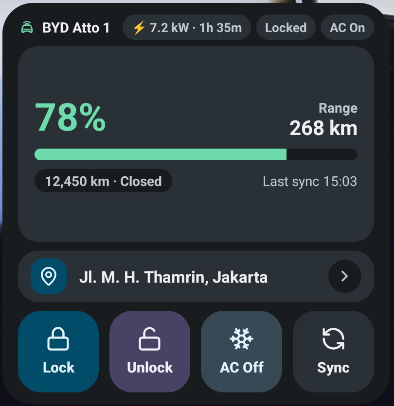
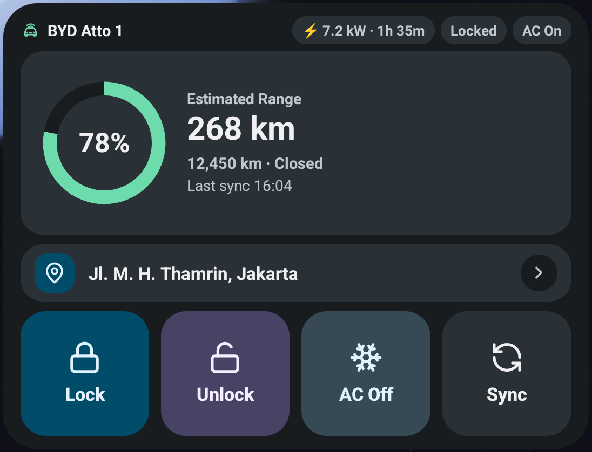
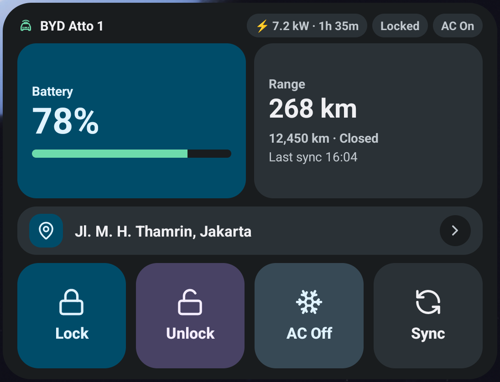
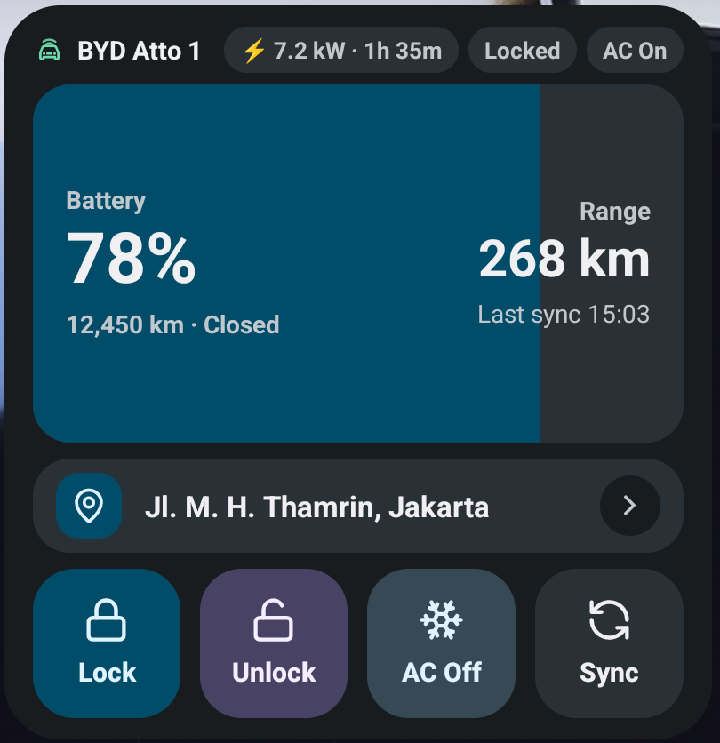
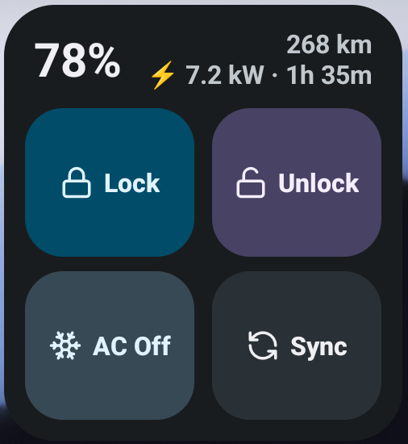
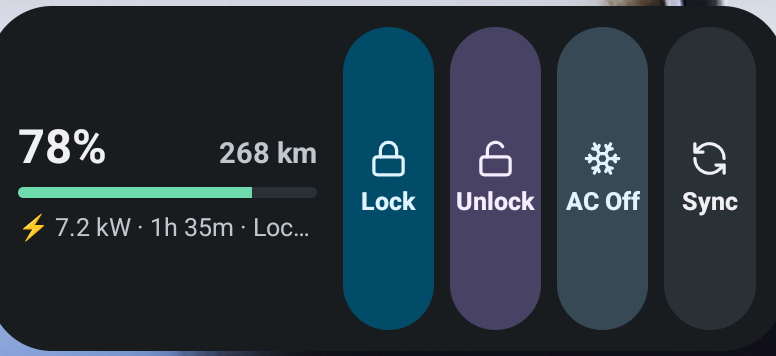
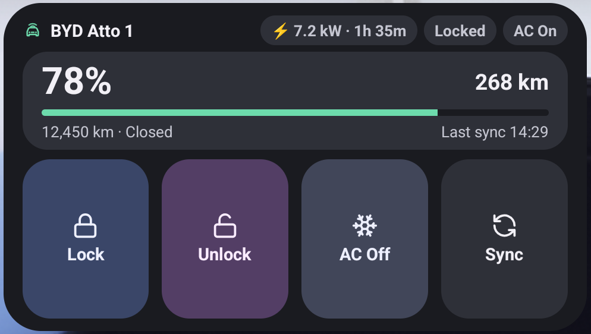

# BYD Open Remote

[](README.md)
[](README.id.md)

Free, open-source, unofficial Android remote control & Material You home-screen widget app for BYD vehicles connected to BYD DiLink Cloud (`com.bydopenremote.app`).

[](https://github.com/kennyric/byd-open-remote/releases/latest)
[](https://github.com/kennyric/byd-open-remote/releases/latest/download/BYD-Open-Remote.apk)

> **Quick Install:** **[Download BYD-Open-Remote.apk](https://github.com/kennyric/byd-open-remote/releases/latest/download/BYD-Open-Remote.apk)** or view **[GitHub Releases](https://github.com/kennyric/byd-open-remote/releases/latest)**, then complete the **[Pre-Login Setup Guide](#pre-login-setup-guide-2nd-account--password--pin)** below before signing in.

> [!IMPORTANT]
> **Security Recommendation — Use a Secondary BYD Account:** Do **not** sign in with your primary owner account. Authorize a secondary email address from your main BYD account with Remote Control permissions, register or sign into that secondary account in the official BYD App, configure its login password and 6-digit Operation PIN, verify a remote command once in the official app, and then sign into BYD Open Remote.

> [!NOTE]
> **Watch Companion Notice:** This project originally started alongside a Huawei Watch GT 4 bridge, so legacy package namespaces (`com.bydwatch.companion`) remain in parts of the codebase. **Huawei Watch integration is currently not working** — use the **Android phone app, Quick Settings tile, and home-screen widgets**, which work standalone without a watch.

> **Disclaimer:** Independent open-source community project by **Kenny Ricardo**, not affiliated with, endorsed by, or connected to BYD Co. Ltd. **Free software — not for commercial sale or resale (*Tidak diperuntukkan untuk jual beli*).**

---

## Feature Demo & Screenshots

*All screenshots below were captured on an Android emulator using synthetic dummy data.*

<table>
  <tr>
    <td align="center"><b>Vehicle Controls &amp; Telemetry</b></td>
    <td align="center"><b>Manual / Auto Climate Popup</b></td>
    <td align="center"><b>Home-Screen 4×3 Widget</b></td>
  </tr>
  <tr>
    <td align="center"></td>
    <td align="center"></td>
    <td align="center"></td>
  </tr>
  <tr>
    <td align="center"><b>4×3 Widget Style Switcher</b></td>
    <td align="center"><b>Action Lock &amp; Biometric Security</b></td>
    <td align="center"><b>In-App 2nd Account Setup Guide</b></td>
  </tr>
  <tr>
    <td align="center"></td>
    <td align="center"></td>
    <td align="center"></td>
  </tr>
  <tr>
    <td align="center" colspan="4"><b>All 4 Selectable Battery Styles (4×3 Widget)</b></td>
  </tr>
  <tr>
    <td align="center"><b>Capsule</b></td>
    <td align="center"><b>Ring</b></td>
    <td align="center"><b>Bento</b></td>
    <td align="center"><b>Tank</b></td>
  </tr>
  <tr>
    <td align="center"></td>
    <td align="center"></td>
    <td align="center"></td>
    <td align="center"></td>
  </tr>
  <tr>
    <td align="center" colspan="4"><b>Resizable to Any Size — Same Styles (Capsule shown)</b></td>
  </tr>
  <tr>
    <td align="center"><b>2×2</b></td>
    <td align="center"><b>4×1</b></td>
    <td align="center" colspan="2"><b>4×2</b></td>
  </tr>
  <tr>
    <td align="center"></td>
    <td align="center"></td>
    <td align="center" colspan="2"></td>
  </tr>
</table>

---

## Pre-Login Setup Guide (2nd Account + Password + PIN)

Configuring a dedicated secondary account in the official **BYD App** takes ~2 minutes and keeps your primary owner session uninterrupted:

1. **Authorize a Secondary Email**
   - In the official BYD App on your **primary owner account**, navigate to **My Car → Vehicle Authorization → Add Authorized Account**.
   - Enter a secondary email address and enable **Remote Control** permissions (Door Lock/Unlock, Climate/AC, Flash/Horn). *The email address does not need to be registered with BYD prior to sending the authorization.*
2. **Register the Secondary Account &amp; Set a Login Password**
   - Sign out of the official BYD App and register or sign in using that secondary email in the **same country/region** as your vehicle.
   - Ensure a login password is set under **My → Settings → Account &amp; Security → Password**. *Accounts configured for email OTP sign-in only cannot authenticate without a password.*
3. **Accept Authorization &amp; Configure the 6-Digit Operation PIN**
   - While signed into the secondary account in the official BYD App, accept the vehicle authorization invitation.
   - Navigate to **My → Settings → Account &amp; Security → Operation Password** and set a **6-digit Operation PIN** (distinct from your account login password).
   - Trigger **Lock** or **Climate On** once in the official BYD App to confirm the Operation PIN is active on BYD Cloud.
4. **Verify VIN &amp; Save Credentials in BYD Open Remote**
   - Open **BYD Open Remote → BYD Account &amp; Region**.
   - Select your **Cloud Region** (for example, `Indonesia (ID)`), then enter the secondary account email, login password, and 6-digit Operation PIN.
   - Tap **Fetch VIN** to verify your credentials and populate your vehicle's VIN, then tap **Save**.

> [!TIP]
> **Why use a secondary account?**
> - Prevents session conflicts and automatic logouts on your primary BYD App when widgets sync in the background.
> - Allows you to revoke or pause third-party remote access at any time from your primary owner account.
> - Ensures the 6-digit Operation PIN is initialized on BYD's servers prior to issuing remote commands.

### Adding Home-Screen Widgets

1. After saving your credentials and verifying that telemetry loads on the homepage, return to your Android home screen.
2. Long-press an empty area on the home screen, select **Widgets**, and locate **BYD Open Remote**.
3. Place **`BYD Remote Status`** (`4×3`, `4×2`, `4×1`, or `2×2`) or **`Car Location`** on your home screen. Widget visual styles, sync intervals, biometric protection, and action buttons can be customized under **Preferences**.

### Troubleshooting

| Issue | Cause | Resolution |
| :--- | :--- | :--- |
| **Save** button is disabled | Credentials or region have not been verified via **Fetch VIN** (or were modified after fetching). | Tap **Fetch VIN** and wait for the VIN field to populate, then tap **Save**. |
| `ACCOUNT_UNBOUND` (`code=2003`) | No verified VIN is bound for the active session, or the vehicle sharing invitation has not been accepted. | Confirm the invitation is accepted in the official BYD App, verify the selected **Cloud Region**, then tap **Fetch VIN** followed by **Save**. |
| `PIN_INVALID` on remote commands | Incorrect 6-digit Operation PIN, or the Operation PIN has not been initialized in the official BYD App. | Verify that **Operation Password** is set under **My → Settings → Account &amp; Security** and test **Lock** once in the official BYD App, then update the PIN in **BYD Account → Fetch VIN → Save**. |
| Official BYD App signs out unexpectedly | Signed into BYD Open Remote with the primary owner account instead of a secondary account. | Switch BYD Open Remote to a dedicated secondary account authorized via **Vehicle Authorization**. |

---

## Features

- **Real-Time Telemetry & Vehicle Health**
  - Pull-to-refresh on the dashboard (`SwipeRefreshLayout`) plus on-demand status sync.
  - State of Charge (`%`), estimated range, aggregate charging power (`kW`) & remaining charge time, total odometer, outside temperature, door/window/trunk closure status, and 4-wheel TPMS tire pressure.
  - Switchable display units for distance (`km` / `mi`), temperature (`°C` / `°F`), and pressure (`kPa` / `PSI` / `bar`).
  - *(Note: BYD DiLink Cloud API exposes aggregate charging power in `kW` and remaining charge duration; raw charger voltage `V` and current `A` are not provided by the cloud telemetry endpoint.)*
- **Remote Vehicle Controls & Custom Homepage Layout**
  - Lock / Unlock doors, Flash Lights, Honk Horn, Vent / Close Windows, Battery Preconditioning Heat, and Driver Seat Heat (`Level 0–2`).
  - **Configurable Single-Flight Action Lock** (Preferences, default **ON**): disables other action controls until the active command completes so taps don't queue unintentionally (can be toggled off in Preferences).
  - Dual Climate Modes: **Auto Climate** (`°C` / `°F`) and **Manual AC Mode** (e.g., BYD Atto 1 / Seagull with Temp Level `1–9`, Fan Level `1–7`, and `Body` / `Body+Feet` / `Feet` vent direction).
  - **Editable Homepage Layout & Custom Buttons**: tap **Edit** on the controls card (or in **Preferences**) to show/hide homepage sections and add, reorder, or customize up to 12 one-tap single-action or **Action Combo** buttons directly on the homepage.
- **Biometric / Device PIN Security (App & Widget)**
  - Protect **App only**, **Widget only**, **Both**, or **Off** under **Preferences → Biometric / PIN Security** using Fingerprint, Face Unlock, or Device PIN.
  - **Configurable Re-auth Grace Period (`0–1440` min):** `0` prompts every time; values `> 0` persist across app restarts/swiping from Recents until expired or device reboot.
  - **Widget-only overlay prompt:** Tapping a protected widget button pops the system biometric sheet directly over your home screen without opening the main app.
  - **Advanced option:** Widget sync/refresh does not require biometrics by default, and can be toggled on under **Advanced options**.
- **Home-Screen Widgets (Material You) & Quick Settings Tile**
  - Adaptive `2×2`, `4×1`, `4×2`, and `4×3` vehicle widgets (each with 4 customizable buttons — default `Lock`, `Unlock`, `AC On/Off`, `Sync`) plus a dedicated **Car Location** widget with reverse-geocoded street names and one-tap navigation handoff.
  - **Live `4×3` Preview in Preferences**: updates live as you change widget style, car model name, units, language, or button assignments (shows synthetic `Sample` telemetry before your first sync); tap any button in the preview or the `1–4` **Widget Buttons** strip to customize it, or tap **Reset** to restore defaults.
  - **Customizable Buttons & Action Combos**: assign any of the 4 widget buttons (with an optional custom short label) to any of 11 single actions (`Lock`, `Unlock`, `AC On/Off`, `Sync`, `Lights`, `Horn`, `Vent Win`, `Close Win`, `Bat Heat`, `Seat Heat`, `Locate`) or your own **Action Combos** (up to 6 ordered actions per combo, e.g., `Unlock → Start AC → Flash Lights`, with per-step `Auto °C` or `Manual` climate presets, `Seat Heat` level, 8 icons, and 4 colors). Combos can be run directly from **Preferences** or any widget slot.
  - **4 Selectable `4×2` / `4×3` Battery Card Styles** in **Preferences**:
    1. **Capsule** — Balanced SoC & Range with a capsule progress bar
    2. **Ring** — Circular ring gauge on left with stacked range metrics
    3. **Bento** — Side-by-side Battery and Range KPI tiles
    4. **Tank** — Full-height tank fill charge card
  - Configurable widget auto-sync interval (minutes or hours).
  - Android Quick Settings tile (**EV Quick Lock**).
- **Multi-Language Support (English & Bahasa Indonesia)**
  - Switch between **System**, **English**, and **Indonesia (Bahasa Indonesia)** inside **Preferences**, applying immediately across the app, home-screen widgets, and Quick Settings tile.
- **Global Regions & Multi-Vehicle Support**
  - Automatic VIN discovery and switching across multiple BYD vehicles on the same account.
  - Supports BYD overseas regions (`eu`, `sg`, `au`, `br`, `jp`, `uz`, `no`, `mx`, `id`, `tr`, `kr`, `in`, `vn`, `sa`, `om`, `kz`) and mainland China (`cn`).
- **On-Device Security**
  - Direct HTTPS + BYD Cloud E2EE communication to regional BYD DiLink Cloud servers — no intermediary backend or analytics SDKs.
  - Password, Operation PIN, session tokens, and cached telemetry remain locally encrypted via Android Keystore-backed `EncryptedSharedPreferences`.

---

## Building & Testing

### Requirements
- Android SDK Platform `34` (`compileSdk 34`, `minSdk 26`, `targetSdk 34`)
- Java `17`

### Build Debug APK & Run Unit Tests

On Linux / macOS:
```bash
./gradlew testDebugUnitTest assembleDebug
```

On Windows PowerShell:
```powershell
.\gradlew.bat testDebugUnitTest assembleDebug
```

The APK (`BYD-Open-Remote-v<version>.apk`) is written to `app/build/outputs/apk/debug/`.

---

## Android Auto Battery & Arrival SoC (Google Maps + Morphe)

BYD Open Remote (`≥ 1.1.0`) publishes your car's live SoC and remaining range to patched Google Maps for Android Auto via [byd-maps-patches](https://github.com/kennyric/byd-maps-patches), showing a dynamic Day/Night battery pill (`86% → 11%`) above the navigation ETA card.

### How to Add the Patch Repo to Morphe
1. Install **[Morphe Manager](https://morphe.software/)** on your phone.
2. Add the patch source using either method:
   - **One-tap link**: Open `https://morphe.software/add-source?github=kennyric/byd-maps-patches`
   - **Manual**: In Morphe Manager → **Settings → Sources → Add**, paste:
     ```text
     https://github.com/kennyric/byd-maps-patches/releases/latest/download/patches-bundle.json
     ```
3. Download **Google Maps `26.44.06.1006895251`** (`versionCode 1068856906`) from APKMirror, select it in Morphe Manager, and patch with the default patches (optionally enable **`Add microG-RE support`** if you want Google sign-in via MicroG-RE).
4. Install the patched APK via **KingInstaller + Shizuku** (or `adb install -i com.android.vending -r ...`) and enable **Ungoogled Maps** in **Settings → Android Auto → Customize launcher**.
   - If you enabled `Add microG-RE support`, set the target package in BYD Open Remote to `org.ungoogled.android.apps.maps.microg` (otherwise the default `org.ungoogled.android.apps.maps` matches).

---

## Repository Structure

```text
.
├── app/               # Android app (com.bydopenremote.app), Material You widgets, BYD cloud client & Robolectric tests
├── docs/screenshots/  # Emulator screenshots used in documentation
└── gradle/            # Gradle wrapper & build scripts
```

---

## Privacy & Security Architecture

- Connects directly from your device to regional BYD DiLink Cloud endpoints (`https`); there is no middleman server or analytics SDK.
- Passwords, 6-digit Operation PINs, session keys, and widget cache live inside Keystore-backed `EncryptedSharedPreferences`.
- Saved credentials and Operation PINs are masked in the UI and never re-populated in plain text fields.

---

## Support

**BYD Open Remote** is free and open-source. If this app makes your daily drive easier, you can support ongoing development:

[](https://ko-fi.com/kenny40049)

### QRIS


---

## Acknowledgments

- Created by **Kenny Ricardo**
- BYD overseas region mapping & cloud protocol research informed by [`hass-byd-vehicle`](https://github.com/tomer-w/hass-byd-vehicle) (MIT).
