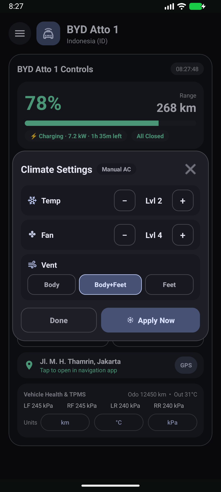
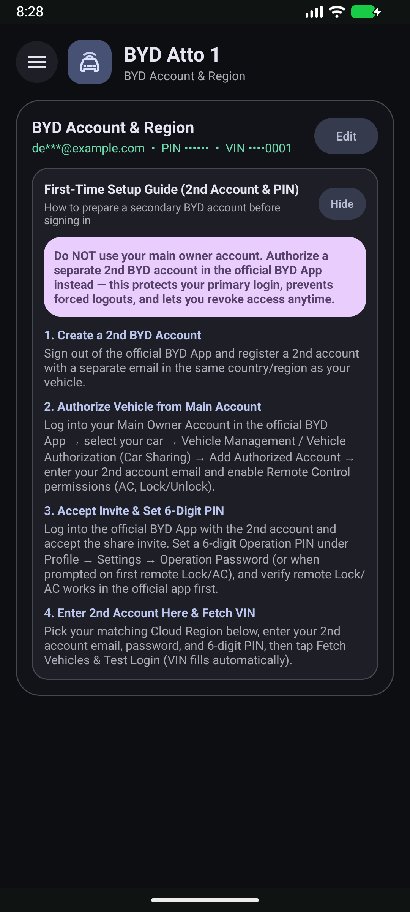
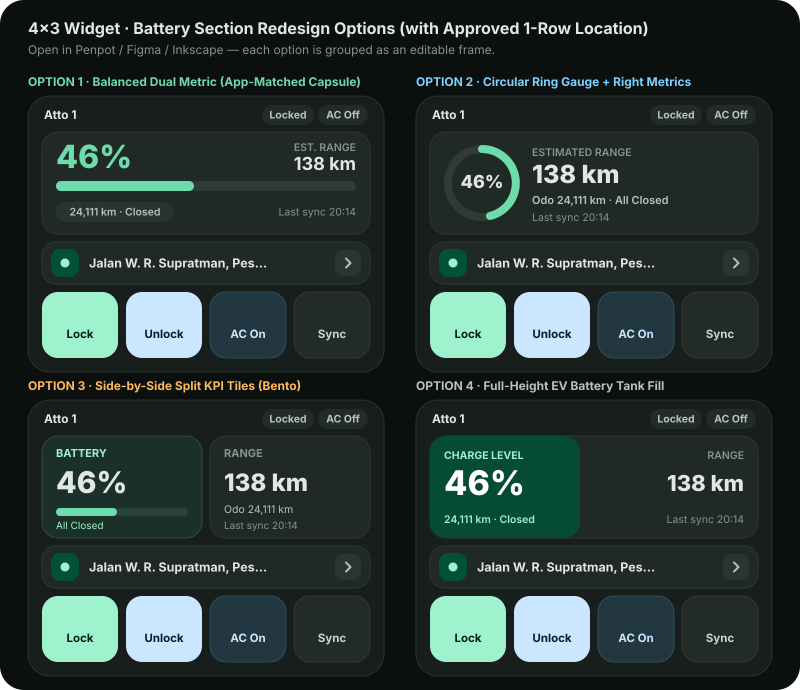

# BYD Open Remote (`No.1`)

Free, open-source, unofficial Android remote control & Material You home-screen widget app for BYD vehicles connected to BYD DiLink Cloud (`com.bydopenremote.app`).

> [!IMPORTANT]
> **Security Recommendation — Always Use a 2nd BYD Account:** Do **not** log in with your primary owner account. Create a secondary BYD account in the official BYD app, share your car to it with Remote Control permissions, set its password & 6-digit Operation PIN, test a remote command once in the official app, and **only then** sign into BYD Open Remote.

> [!NOTE]
> **Watch Companion Notice:** This project originally started alongside a Huawei Watch GT 4 bridge, so legacy package namespaces (`com.bydwatch.companion`) remain in parts of the codebase. **Huawei Watch integration is currently not working** — use the **Android phone app, Quick Settings tile, and home-screen widgets**, which work standalone without a watch.

> **Disclaimer:** Independent open-source community project by **Kenny Ricardo**, not affiliated with, endorsed by, or connected to BYD Co. Ltd. **Free software — not for commercial sale or resale (*Tidak diperuntukkan untuk jual beli*).**

---

## Feature Demo & Screenshots

*All screenshots below were captured on an Android emulator using synthetic dummy data.*

<table>
  <tr>
    <td align="center"><b>Vehicle Controls &amp; Telemetry</b></td>
    <td align="center"><b>Manual / Auto Climate Popup</b></td>
    <td align="center"><b>Home-Screen 4×3 Widget</b></td>
  </tr>
  <tr>
    <td align="center"></td>
    <td align="center"></td>
    <td align="center"></td>
  </tr>
  <tr>
    <td align="center"><b>4×3 Widget Style Switcher</b></td>
    <td align="center"><b>In-App 2nd Account Setup Guide</b></td>
    <td align="center"><b>All 4 Selectable Battery Styles</b></td>
  </tr>
  <tr>
    <td align="center"></td>
    <td align="center"></td>
    <td align="center"></td>
  </tr>
</table>

---

## Pre-Login Setup Guide (2nd Account + Password + PIN)

Setting up a dedicated secondary account takes ~2 minutes in the official **BYD App** and keeps your primary owner session uninterrupted:

1. **Create a 2nd BYD Account (Official BYD App)**
   - Sign out of your main account in the official BYD App.
   - Register a new secondary account with a separate email address in the **exact same country/region** as your vehicle, and set its **login password** (ensure you know the email + password, rather than OTP-only login).
2. **Share & Authorize Vehicle from Your Main Account**
   - Log back into your **Main Owner Account** in the official BYD App.
   - Select your car → **Vehicle Management / Vehicle Authorization (Car Sharing)** → **Add Authorized Account**.
   - Enter your **2nd account email** and grant **Remote Control** permissions (Door Lock/Unlock, Climate/AC, Flash/Horn).
3. **Accept Invite & Configure the 6-Digit Operation PIN**
   - Sign back into the official BYD App using your **2nd account** and accept the vehicle share invitation.
   - Open **Profile → Settings → Operation Password** (or follow the prompt on your first Lock/AC tap) and set a **6-digit Operation PIN**.
   - Tap **Lock** or **Climate On** once inside the official BYD App to confirm the 2nd account's password & Operation PIN are active on BYD Cloud.
4. **Sign In on BYD Open Remote & Fetch VIN**
   - Open **BYD Open Remote** → **BYD Account & Region**.
   - Select your **Cloud Region**, enter your **2nd account email, password, and 6-digit Operation PIN**, then tap **Fetch Vehicles & Test Login** (your VIN fills in automatically).

> [!TIP]
> **Why do this first?**
> - Prevents forced session logouts on your main BYD App when home-screen widgets auto-sync.
> - Lets you revoke or pause third-party remote access anytime from your main owner account.
> - Ensures your 6-digit Operation PIN is initialized on BYD's servers (BYD rejects remote control commands until the PIN has been set in the official app).

---

## Features

- **Real-Time Telemetry & Vehicle Health**
  - State of Charge (`%`), estimated range, aggregate charging power (`kW`) & remaining charge time, total odometer, outside temperature, door/window/trunk closure status, and 4-wheel TPMS tire pressure.
  - Switchable display units for distance (`km` / `mi`), temperature (`°C` / `°F`), and pressure (`kPa` / `PSI` / `bar`).
  - *(Note: BYD DiLink Cloud API exposes aggregate charging power in `kW` and remaining charge duration; raw charger voltage `V` and current `A` are not provided by the cloud telemetry endpoint.)*
- **Remote Vehicle Controls**
  - Lock / Unlock doors, Flash Lights, Honk Horn, Vent / Close Windows, Battery Preconditioning Heat, and Driver Seat Heat (`Level 0–2`).
  - Dual Climate Modes: **Auto Climate** (`°C` / `°F`) and **Manual AC Mode** (e.g., BYD Atto 1 / Seagull with Temp Level `1–9`, Fan Level `1–7`, and `Body` / `Body+Feet` / `Feet` vent direction).
- **Home-Screen Widgets (Material You) & Quick Settings Tile**
  - Adaptive `2×2`, `4×1`, `4×2`, and `4×3` vehicle widgets (`Lock`, `Unlock`, `AC On/Off`, `Sync`) plus a dedicated **Car Location** widget with reverse-geocoded street names and one-tap navigation handoff.
  - **4 Selectable `4×3` Battery Card Styles** in **Preferences**:
    1. **Capsule** — Balanced SoC & Range with a thick capsule progress bar
    2. **Ring Gauge** — Circular radial SoC gauge with stacked range metrics
    3. **Bento Split** — Side-by-side Battery and Range KPI tiles
    4. **Tank Fill** — Full-height horizontal fill progress card
  - Configurable widget auto-sync interval (minutes or hours).
  - Android Quick Settings tile (**EV Quick Lock**).
- **Multi-Language Support (English & Bahasa Indonesia)**
  - Switch between **System**, **English**, and **Indonesia (Bahasa Indonesia)** inside **Preferences**, applying immediately across the app, home-screen widgets, and Quick Settings tile.
- **Global Regions & Multi-Vehicle Support**
  - Automatic VIN discovery and switching across multiple BYD vehicles on the same account.
  - Supports BYD overseas regions (`eu`, `sg`, `au`, `br`, `jp`, `uz`, `no`, `mx`, `id`, `tr`, `kr`, `in`, `vn`, `sa`, `om`, `kz`) and mainland China (`cn`).
- **On-Device Security**
  - Direct HTTPS + BYD Cloud E2EE communication to regional BYD DiLink Cloud servers — no intermediary backend or analytics SDKs.
  - Password, Operation PIN, session tokens, and cached telemetry remain locally encrypted via Android Keystore-backed `EncryptedSharedPreferences`.

---

## Building & Testing

### Requirements
- Android SDK Platform `34` (`compileSdk 34`, `minSdk 26`, `targetSdk 34`)
- Java `17`

### Build Debug APK & Run Unit Tests

On Linux / macOS:
```bash
./gradlew testDebugUnitTest assembleDebug
```

On Windows PowerShell:
```powershell
.\gradlew.bat testDebugUnitTest assembleDebug
```

Assembled APKs (`byd-open-remote-v<version>-<variant>.apk`) are written to `app/build/outputs/apk/debug/`.

---

## Repository Structure

```text
.
├── app/               # Android app (com.bydopenremote.app), Material You widgets, BYD cloud client & Robolectric tests
├── docs/screenshots/  # Emulator screenshots & vector artboards used in documentation
└── gradle/            # Gradle wrapper & build scripts
```

---

## Privacy & Security Architecture

- Connects directly from your device to regional BYD DiLink Cloud endpoints (`https`); there is no middleman server or analytics SDK.
- Passwords, 6-digit Operation PINs, session keys, and widget cache live inside Keystore-backed `EncryptedSharedPreferences`.
- Saved credentials and Operation PINs are masked in the UI and never re-populated in plain text fields.

---

## Acknowledgments

- Created by **Kenny Ricardo**
- BYD overseas region mapping & cloud protocol research informed by [`hass-byd-vehicle`](https://github.com/tomer-w/hass-byd-vehicle) (MIT).
