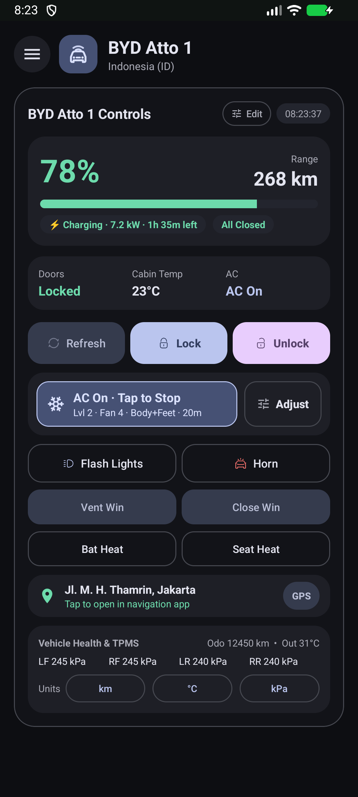
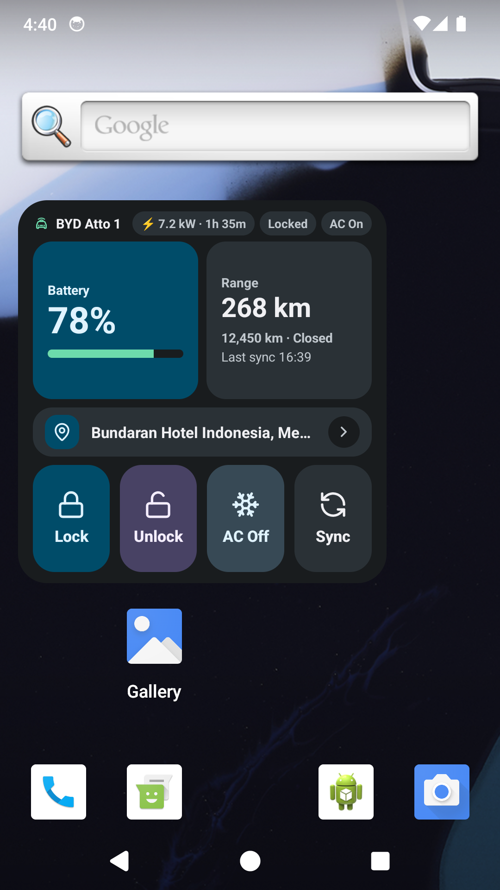
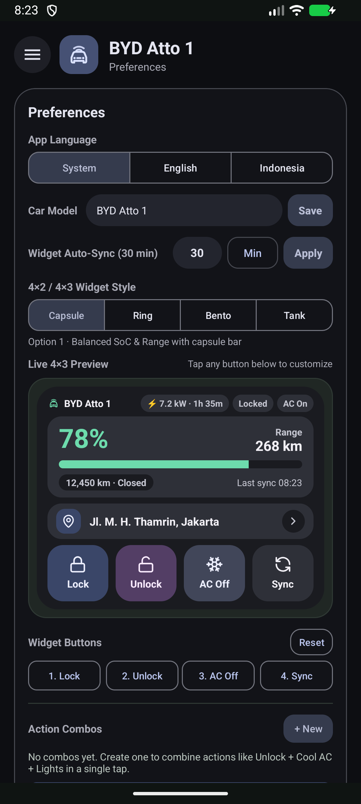

# BYD Open Remote

Free, open-source, unofficial Android remote control & Material You home-screen widget app for BYD vehicles connected to BYD DiLink Cloud (`com.bydopenremote.app`).

[](https://github.com/kennyric/byd-open-remote/releases/latest)
[-00658E?style=for-the-badge)](https://github.com/kennyric/byd-open-remote/releases/download/v1.0.1/BYD-Open-Remote-v1.0.1.apk)

> **Quick Install:** **[Tap here to download the Android app (.apk)](https://github.com/kennyric/byd-open-remote/releases/download/v1.0.1/BYD-Open-Remote-v1.0.1.apk)** or open the **[Releases page](https://github.com/kennyric/byd-open-remote/releases/latest)**, then follow the **[2nd account setup guide](#pre-login-setup-guide-2nd-account--password--pin)** below before signing in.
>
> *First time sideloading an Android APK?* Open the downloaded `.apk` file → allow **Install unknown apps** for your browser/Files app if prompted. If Google Play Protect shows a warning about an unrecognized developer, tap **More details → Install anyway**.

<details>
<summary><b>🇮🇩 Panduan Cepat Bahasa Indonesia (Klik untuk buka: Cara Install, Akun ke-2, Login &amp; Pasang Widget)</b></summary>

1. **Install Aplikasi (.apk)**
   - Unduh **`BYD-Open-Remote-v1.0.1.apk`** lewat tombol di atas, lalu buka file tersebut.
   - Jika diminta izin Android, aktifkan **Izinkan dari sumber ini (*Install unknown apps*)**. Jika muncul peringatan Google Play Protect (*Pengembang tidak dikenal*), ketuk **Selengkapnya / More details → Tetap instal (*Install anyway*)**.
2. **Buat Akun BYD ke-2 &amp; Kata Sandi Login** *(jangan pakai akun utama)*
   - Keluar (*Log out*) dari akun utama di aplikasi resmi **BYD App**.
   - Daftar akun ke-2 memakai **email berbeda** di negara/wilayah yang sama (mis. Indonesia).
   - Pastikan akun ke-2 punya **Kata Sandi Login** — jika daftarnya pakai kode OTP email tanpa password, buka **Saya (*My*) → Pengaturan ⚙️ (*Settings*) → Akun &amp; Keamanan (*Account & Security*) → Kata Sandi (*Password*)** untuk membuat password terlebih dahulu.
3. **Bagikan Akses Mobil dari Akun Utama**
   - Login lagi ke **Akun Pemilik Utama** di aplikasi resmi **BYD App**.
   - Buka **Mobil Saya (*My Car*) → Otorisasi Kendaraan / Manajemen Kendaraan (*Vehicle Authorization / Car Sharing*) → Tambah Akun Resmi (*Add Authorized Account*)**.
   - Masukkan **email akun ke-2** dan centang izin **Kontrol Jarak Jauh / Remote Control** (Kunci/Buka Kunci, AC, dll.).
4. **Terima Undangan &amp; Atur PIN Operasi 6-Digit**
   - Login kembali ke aplikasi resmi **BYD App** memakai **akun ke-2**, lalu **terima undangan berbagi mobil**.
   - Buka **Saya → Pengaturan ⚙️ → Akun &amp; Keamanan → Kata Sandi Operasi (*Operation Password*)** untuk mengatur **PIN Operasi 6-digit** (beda dengan password login!).
   - Coba tekan tombol **Kunci** atau **AC** sekali di aplikasi resmi BYD untuk memastikan PIN aktif.
5. **Login di BYD Open Remote (`Ambil VIN` → `Simpan`)**
   - Buka **BYD Open Remote** → masuk ke **Akun BYD &amp; Wilayah** → pilih **Indonesia (ID)** (sesuai negara akun).
   - Masukkan **email akun ke-2**, **Kata Sandi Login** *(password login, bukan kode OTP)*, dan **PIN Kontrol 6-Digit** *(Operation PIN)*.
   - Ketuk **Ambil VIN (*Fetch VIN*)** dan tunggu hingga **Nomor Rangka (VIN)** terisi otomatis. *(Tombol **Simpan** memang dinonaktifkan sebelum Ambil VIN berhasil.)*
   - Setelah VIN muncul, ketuk **Simpan (*Save*)** — Anda akan otomatis masuk ke halaman utama Kontrol dengan notifikasi **"Login akun berhasil"**.
6. **Pasang Widget di Layar Utama HP Android**
   - Setelah berhasil login, kembali ke layar utama HP → **tekan &amp; tahan area kosong** di layar → pilih **Widget** → cari **BYD Open Remote** → seret widget **`4×3`**, **`4×2`**, **`4×1`**, **`2×2`**, atau **Lokasi Mobil** ke layar utama.
   - *(Opsional)* Bahasa aplikasi bisa diganti ke **Indonesia** di menu **Preferensi (*Preferences*) → Bahasa Aplikasi (*App Language*)**.

</details>

> [!IMPORTANT]
> **Security Recommendation — Always Use a 2nd BYD Account:** Do **not** log in with your primary owner account. Create a secondary BYD account in the official BYD app, share your car to it with Remote Control permissions, set its password & 6-digit Operation PIN, test a remote command once in the official app, and **only then** sign into BYD Open Remote.

> [!NOTE]
> **Watch Companion Notice:** This project originally started alongside a Huawei Watch GT 4 bridge, so legacy package namespaces (`com.bydwatch.companion`) remain in parts of the codebase. **Huawei Watch integration is currently not working** — use the **Android phone app, Quick Settings tile, and home-screen widgets**, which work standalone without a watch.

> **Disclaimer:** Independent open-source community project by **Kenny Ricardo**, not affiliated with, endorsed by, or connected to BYD Co. Ltd. **Free software — not for commercial sale or resale (*Tidak diperuntukkan untuk jual beli*).**

---

## Feature Demo & Screenshots

*All screenshots below were captured on an Android emulator using synthetic dummy data.*

<table>
  <tr>
    <td align="center"><b>Vehicle Controls &amp; Telemetry</b></td>
    <td align="center"><b>Manual / Auto Climate Popup</b></td>
    <td align="center"><b>Home-Screen 4×3 Widget</b></td>
  </tr>
  <tr>
    <td align="center"></td>
    <td align="center"></td>
    <td align="center"></td>
  </tr>
  <tr>
    <td align="center"><b>4×3 Widget Style Switcher</b></td>
    <td align="center"><b>In-App 2nd Account Setup Guide</b></td>
    <td align="center"><b>All 4 Selectable Battery Styles</b></td>
  </tr>
  <tr>
    <td align="center"></td>
    <td align="center"></td>
    <td align="center"></td>
  </tr>
</table>

---

## Pre-Login Setup Guide (2nd Account + Password + PIN)

Setting up a dedicated secondary account takes ~2 minutes in the official **BYD App** and keeps your primary owner session uninterrupted:

> **Two different secrets in BYD:** BYD uses **(a) an Account Login Password** to sign in *and* **(b) a 6-digit Operation PIN** to unlock/lock/start AC. If you sign into the official BYD App using email OTP codes, you must set a login password first before third-party login can work.

1. **Create a 2nd BYD Account &amp; Set a Login Password (Official BYD App)**
   - Sign out of your main account in the official BYD App.
   - Register a new secondary account with a separate email address in the **exact same country/region** as your vehicle.
   - Set its **Account Login Password** under **My (`Saya`) → Settings ⚙️ → Account &amp; Security (`Akun & Keamanan`) → Password (`Kata Sandi`)** *(OTP-only accounts without a password cannot sign in here)*.
2. **Share &amp; Authorize Vehicle from Your Main Account**
   - Log back into your **Main Owner Account** in the official BYD App.
   - Open **My Car (`Mobil Saya`) → Vehicle Authorization / Car Sharing (`Otorisasi Kendaraan / Manajemen Kendaraan`) → Add Authorized Account (`Tambah Akun`)**.
   - Enter your **2nd account email** and grant **Remote Control** permissions (Door Lock/Unlock, Climate/AC, Flash/Horn).
3. **Accept Invite &amp; Configure the 6-Digit Operation PIN**
   - Sign back into the official BYD App using your **2nd account** and accept the vehicle share invitation.
   - Open **My (`Saya`) → Settings ⚙️ → Account &amp; Security → Operation Password (`Kata Sandi Operasi`)** (or follow the prompt on your first Lock/AC tap) and set a **6-digit Operation PIN**.
   - Tap **Lock** or **Climate On** once inside the official BYD App to confirm the 2nd account's password &amp; Operation PIN are active on BYD Cloud.
4. **Sign In on BYD Open Remote (`Fetch VIN` → `Save`)**
   - Open **BYD Open Remote** → **BYD Account &amp; Region**.
   - Select your **Cloud Region** (e.g. `Indonesia (ID)`), then enter your **2nd account email**, **Account Login Password**, and **6-digit Operation PIN**.
   - Tap **Fetch VIN** first — your vehicle VIN fills in automatically and unlocks the **Save** button *(**Save** stays disabled until **Fetch VIN** verifies the account &amp; region)*.
   - Tap **Save** to return to the homepage with `"Account login successful"` and trigger an immediate telemetry refresh.

> [!TIP]
> **Why do this first?**
> - Prevents forced session logouts on your main BYD App when home-screen widgets auto-sync.
> - Lets you revoke or pause third-party remote access anytime from your main owner account.
> - Ensures your 6-digit Operation PIN is initialized on BYD's servers (BYD rejects remote control commands until the PIN has been set in the official app).

### Adding Home-Screen Widgets (Android)

1. After saving your account and confirming telemetry loads on the homepage, return to your phone's Android home screen.
2. **Long-press** an empty area of your home screen → tap **Widgets** → scroll to **BYD Open Remote**.
3. Drag **`BYD Remote Status`** (`4×3`, `4×2`, `4×1`, or `2×2`) or **`Car Location`** onto your home screen, then customize card styles, sync interval, and button slots anytime in **Preferences**.

### Quick Troubleshooting

| Symptom / Error | Cause | How to Fix |
| :--- | :--- | :--- |
| **Save** button is greyed out / disabled | Account credentials/region haven't been verified via **Fetch VIN** (or were edited afterward). | Tap **Fetch VIN** first and wait for the VIN field to populate, then tap **Save**. |
| `ACCOUNT_UNBOUND` / `code=2003` (*"Akun ini tidak terikat dengan kendaraan"*) | No verified vehicle VIN bound for the current region/account, or the 2nd-account car-share invite hasn't been accepted yet. | Confirm the car-share invite is accepted in the official BYD App, verify the matching **Cloud Region**, go to **BYD Account** → tap **Fetch VIN** → tap **Save**. |
| `PIN_INVALID` on Lock/Unlock/AC | Wrong 6-digit Operation PIN, entered login password instead of PIN, or PIN not yet set in official BYD App. | Test **Lock** once in the official BYD App (set **Operation Password** under **Settings → Account &amp; Security** if needed), then re-enter the 6-digit PIN in **BYD Account** → **Fetch VIN** → **Save**. |
| Official BYD App logs out unexpectedly | Logged into BYD Open Remote using your **Main Owner Account** instead of a shared 2nd account. | Switch to a dedicated **2nd BYD Account** authorized via Car Sharing so widget sync never kicks out your main phone session. |

---

## Features

- **Real-Time Telemetry & Vehicle Health**
  - State of Charge (`%`), estimated range, aggregate charging power (`kW`) & remaining charge time, total odometer, outside temperature, door/window/trunk closure status, and 4-wheel TPMS tire pressure.
  - Switchable display units for distance (`km` / `mi`), temperature (`°C` / `°F`), and pressure (`kPa` / `PSI` / `bar`).
  - *(Note: BYD DiLink Cloud API exposes aggregate charging power in `kW` and remaining charge duration; raw charger voltage `V` and current `A` are not provided by the cloud telemetry endpoint.)*
- **Remote Vehicle Controls & Custom Homepage Layout**
  - Lock / Unlock doors, Flash Lights, Honk Horn, Vent / Close Windows, Battery Preconditioning Heat, and Driver Seat Heat (`Level 0–2`).
  - Dual Climate Modes: **Auto Climate** (`°C` / `°F`) and **Manual AC Mode** (e.g., BYD Atto 1 / Seagull with Temp Level `1–9`, Fan Level `1–7`, and `Body` / `Body+Feet` / `Feet` vent direction).
  - **Editable Homepage Layout & Custom Buttons**: tap **Edit** on the controls card (or in **Preferences**) to show/hide homepage sections and add, reorder, or customize up to 12 one-tap single-action or **Action Combo** buttons directly on the homepage.
- **Home-Screen Widgets (Material You) & Quick Settings Tile**
  - Adaptive `2×2`, `4×1`, `4×2`, and `4×3` vehicle widgets (each with 4 customizable buttons — default `Lock`, `Unlock`, `AC On/Off`, `Sync`) plus a dedicated **Car Location** widget with reverse-geocoded street names and one-tap navigation handoff.
  - **Live `4×3` Preview in Preferences**: updates live as you change widget style, car model name, units, language, or button assignments (shows synthetic `Sample` telemetry before your first sync); tap any button in the preview or the `1–4` **Widget Buttons** strip to customize it, or tap **Reset** to restore defaults.
  - **Customizable Buttons & Action Combos**: assign any of the 4 widget buttons (with an optional custom short label) to any of 11 single actions (`Lock`, `Unlock`, `AC On/Off`, `Sync`, `Lights`, `Horn`, `Vent Win`, `Close Win`, `Bat Heat`, `Seat Heat`, `Locate`) or your own **Action Combos** (up to 6 ordered actions per combo, e.g., `Unlock → Start AC → Flash Lights`, with per-step `Auto °C` or `Manual` climate presets, `Seat Heat` level, 8 icons, and 4 colors). Combos can be run directly from **Preferences** or any widget slot.
  - **4 Selectable `4×3` Battery Card Styles** in **Preferences**:
    1. **Capsule** — Balanced SoC & Range with a capsule progress bar
    2. **Ring** — Circular ring gauge on left with stacked range metrics
    3. **Bento** — Side-by-side Battery and Range KPI tiles
    4. **Tank** — Full-height tank fill charge card
  - Configurable widget auto-sync interval (minutes or hours).
  - Android Quick Settings tile (**EV Quick Lock**).
- **Multi-Language Support (English & Bahasa Indonesia)**
  - Switch between **System**, **English**, and **Indonesia (Bahasa Indonesia)** inside **Preferences**, applying immediately across the app, home-screen widgets, and Quick Settings tile.
- **Global Regions & Multi-Vehicle Support**
  - Automatic VIN discovery and switching across multiple BYD vehicles on the same account.
  - Supports BYD overseas regions (`eu`, `sg`, `au`, `br`, `jp`, `uz`, `no`, `mx`, `id`, `tr`, `kr`, `in`, `vn`, `sa`, `om`, `kz`) and mainland China (`cn`).
- **On-Device Security**
  - Direct HTTPS + BYD Cloud E2EE communication to regional BYD DiLink Cloud servers — no intermediary backend or analytics SDKs.
  - Password, Operation PIN, session tokens, and cached telemetry remain locally encrypted via Android Keystore-backed `EncryptedSharedPreferences`.

---

## Building & Testing

### Requirements
- Android SDK Platform `34` (`compileSdk 34`, `minSdk 26`, `targetSdk 34`)
- Java `17`

### Build Debug APK & Run Unit Tests

On Linux / macOS:
```bash
./gradlew testDebugUnitTest assembleDebug
```

On Windows PowerShell:
```powershell
.\gradlew.bat testDebugUnitTest assembleDebug
```

The APK (`BYD-Open-Remote-v<version>.apk`) is written to `app/build/outputs/apk/debug/`.

---

## Repository Structure

```text
.
├── app/               # Android app (com.bydopenremote.app), Material You widgets, BYD cloud client & Robolectric tests
├── docs/screenshots/  # Emulator screenshots & vector artboards used in documentation
└── gradle/            # Gradle wrapper & build scripts
```

---

## Privacy & Security Architecture

- Connects directly from your device to regional BYD DiLink Cloud endpoints (`https`); there is no middleman server or analytics SDK.
- Passwords, 6-digit Operation PINs, session keys, and widget cache live inside Keystore-backed `EncryptedSharedPreferences`.
- Saved credentials and Operation PINs are masked in the UI and never re-populated in plain text fields.

---

## Acknowledgments

- Created by **Kenny Ricardo**
- BYD overseas region mapping & cloud protocol research informed by [`hass-byd-vehicle`](https://github.com/tomer-w/hass-byd-vehicle) (MIT).
